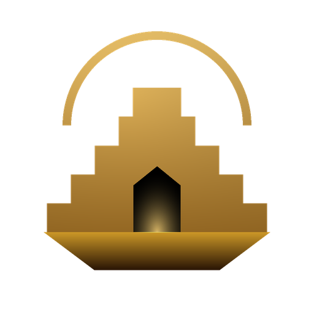
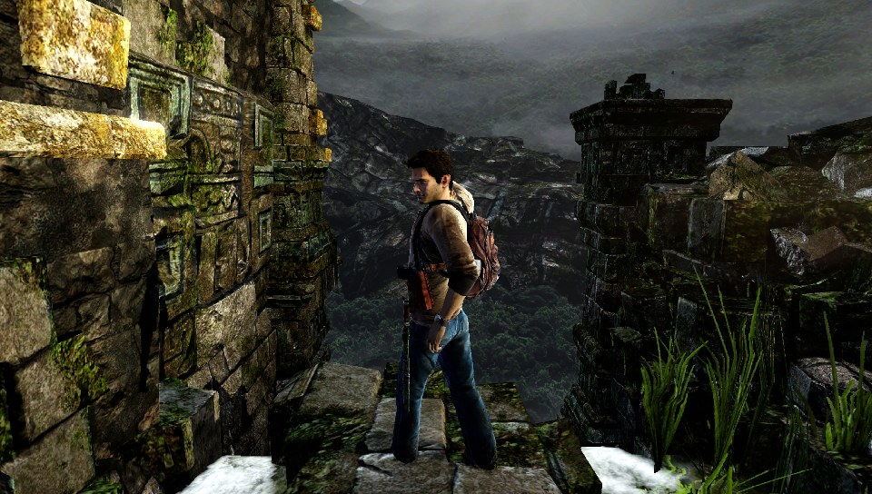
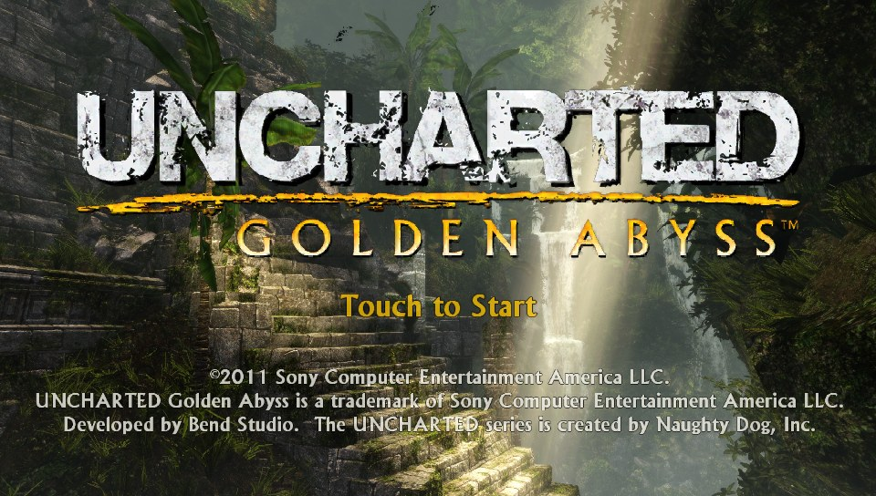
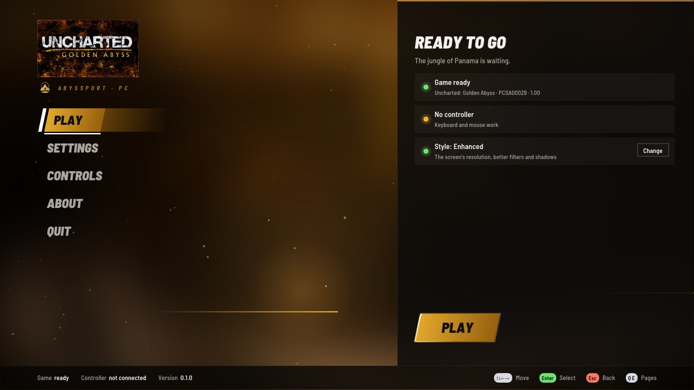
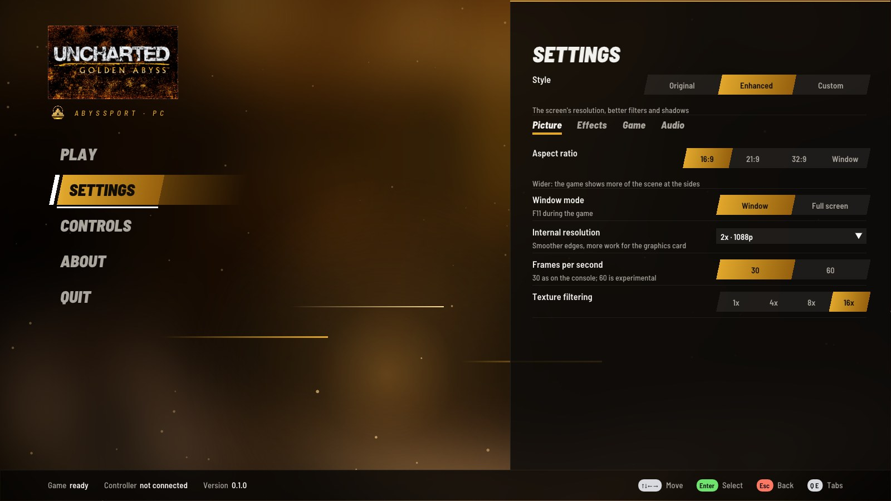
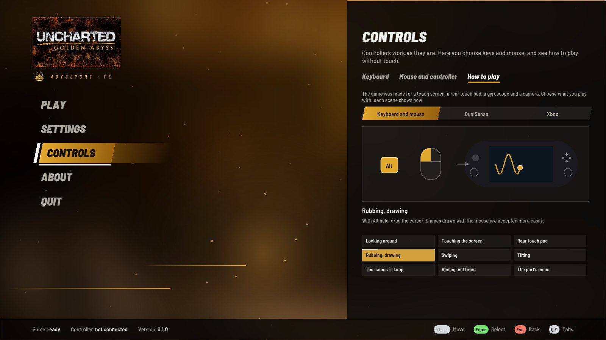

# abyssport

**Uncharted: Golden Abyss (PS Vita) as a native Windows program.**

<a href="https://recomplauncher.com"><picture><source media="(prefers-color-scheme: dark)" srcset="https://recomplauncher.com/assets/press/launcher/badge-light.svg"></picture></a>

The game's ARM code is recompiled ahead of time into a Windows program, with a runtime that stands in for the Vita's
system and hardware. It is not an emulator: once prepared, the game is a program of your PC.

Nothing of the game ships. You need your own copy of the game version 1.00, the US release PCSA00029 or the European one PCSF00012, and the
Vita firmware update file (PUP).

**Status: early.** The game starts, a new campaign begins and the prologue plays; nothing has been played through
yet. See [Known issues](#known-issues).

## How to play

1. Unzip the release anywhere with about 9 GB free.
2. Open `abyssport.exe`. The first time it asks for your copy of the game (the `PCSA00029` or `PCSF00012` folder
   copied off the console, with its licence `sce_sys/package/work.bin`) and the firmware file `PSVUPDAT.PUP`
   (system update 3.74).
3. Press **Prepare**. Once only, about 15 minutes: the game is decrypted, its code recompiled to C and compiled on
   your PC with the compiler that comes with the release. Nothing is installed in the system and nothing is
   downloaded.
4. Press **Play**. In the game, F1 opens the menu with every setting and control.

The game's language, text and voices, is in the launcher's Settings, Game: the US copy has English, French and
Spanish; the European one English (UK), French, German, Italian and Dutch. Automatic follows Windows' language.

## Screenshots

| | |
|---|---|
|  |  |
|  |  |

The two pictures of the game are frames at the Vita's own 960x544; the port can draw it at up to six times that.

## Features

- **Higher resolution**: the game drawn at up to six times the Vita's 544 lines (F2 changes it while you play), with
  FSR 3.1 anti-aliasing, a sharper texture filter, ambient occlusion and softer shadows.
- **Wider screens**: 16:9, 21:9 and 32:9, or the window's own shape; the game shows more of the scene at the sides.
- **Field of view and view distance**: rocks and foliage fade out further away.
- **60 frames per second**, experimental; the game was made for 30.
- **Three styles**: Original (as on the console), Enhanced (your screen's resolution, better filters and shadows)
  and Custom.
- **Keyboard and mouse**: mouse look, every key and the mouse's five buttons on any action, and the game's button
  prompts showing your own keys.
- **Controllers**: Xbox, PlayStation, Switch and most others, with each one's button symbols; the gyroscope of a
  DualShock 4, DualSense or Switch Pro tilts like the console.
- **The Vita's touch screen, rear pad, tilt and camera on a PC**: the launcher's "How to play" shows each one as a
  small moving scene, for keyboard and mouse, a DualSense or an Xbox controller.
- **A launcher and an in-game menu** (F1) with the same pages, in English, Italian, Portuguese (Brazil) and Spanish.
- **The game's menus with a controller or the arrows**: the console's menus are touch only; here the D-pad or the
  arrow keys move through them and Cross / A or Space presses.
- **Saved games** are written and read back, in the game's own format.

## Requirements

- Windows 10 version 1903 or later, 64-bit.
- A graphics card with Direct3D 12 or Vulkan.
- About 9 GB of free disk space.
- Your own copy of Uncharted: Golden Abyss, US release **PCSA00029** or European release **PCSF00012**, version **1.00**:
  the `PCSA00029` or `PCSF00012` folder copied off your console, with its licence `sce_sys/package/work.bin`.
- The PS Vita system update file `PSVUPDAT.PUP`, version 3.74.

## Controls

The full guide, key by key: [docs/controls.md](docs/controls.md). The defaults on a keyboard and mouse:

| Action | Key |
|---|---|
| Move | W, A, S, D |
| Look | Mouse |
| Fire / aim | Left / right mouse button |
| Jump, climb (Cross) | Space |
| Cover, roll, drop (Circle) | Left Shift |
| Melee (Square) | F |
| Pick up, interact (Triangle) | E |
| Touch the screen / the rear pad | Hold Alt, then the left / right mouse button |
| In-game menu | F1 |
| Game menus | Arrows, Space to press, Esc or Backspace to go back |

Every key and mouse button can be changed on the launcher's Controls page or in the in-game menu.

## Settings

The launcher and the in-game menu (F1) have the same pages: Picture (aspect ratio, window, internal resolution,
frames per second), Effects (texture filtering, FSR, ambient occlusion, shadows), Game (field of view, view distance,
language) and Audio. The internal resolution, full screen and the performance display apply at once; the others at
the next start, which "Back to the launcher" makes one click away.

| Key | What it does |
|---|---|
| F1 | The in-game menu |
| F2 | Cycles the internal resolution, 1x to 6x |
| F4 | FSR anti-aliasing off and on |
| F10 | Cycles the performance display |
| F11 | Window or full screen |

## Known issues

- **Only the prologue has been played.** A new campaign starts and its first chapter plays; nothing past it has been
  tried, so a later chapter may crash, stop or draw wrong. Reports with `abyss.log` are welcome.
- **One release of the game only**: the US one, PCSA00029, or the European one, PCSF00012, version 1.00. Other regions and patched versions are
  not supported.
- **60 frames per second is experimental**: the game was made for 30, and at 60 some things may move or time wrong.
- **The raw mouse look (F8) is experimental.**
- **The in-game menu and the key prompts on a keyboard and mouse are new** and little tested.
- **Windows only**, 64-bit. Linux and the Steam Deck have not been tried.
- **The first start takes about 15 minutes and 9 GB**: the game's code is compiled on your PC, once.

## Troubleshooting

- **Prepare stops with an error**: check that the copy is the US release PCSA00029 or the European PCSF00012, at version 1.00, that it has
  `sce_sys/package/work.bin`, and that the firmware file is `PSVUPDAT.PUP` of system update 3.74. A second run picks
  up the files already compiled.
- **The game crashes or stops**: what it prints goes to `abyss.log` beside its files
  (`game\library\decrypted\PCSA00029\recomp`). Attach it to a bug report, and press F5 just before the problem if
  you can: it writes a marker in the log.
- **The game is not smooth**: choose the Original style, a lower internal resolution, or 30 frames per second.

## Building from source

abyssport is built on Windows. You need Python 3.11 or later and CMake 3.25 or later; the compiler is fetched for you.

1. `pip install -r tools/requirements.txt`
2. `python tools/get_toolchain.py`: llvm-mingw (Clang) and Ninja into `toolchain/`. Nothing is installed in the
   system.
3. `python tools/make_game.py <your copy of the game> <PSVUPDAT.PUP>`: the game's code and data, made from your
   copy and Sony's firmware update file (3.74) into `game/library`. About ten minutes.
4. `cmake --preset pc-x64`, then `cmake --build --preset pc-x64-release`. The first build takes about ten minutes:
   the game is 425 MB of C.
5. `build\pc-x64\abyssport.exe`, the launcher (or `play.cmd`, which starts the game directly)

The release: `python tools/make_package.py` puts the launcher, the runtime compiled (`libabyssrt.a`), the tools,
an embedded Python and the x86-64 part of llvm-mingw in `dist/abyssport-<version>` and zips it. On the player's PC
`tools/build_game.py` compiles the game's code and links it to that runtime.

## How this was made

A PS Vita game is ARM code. abyssport's tools decrypt your copy, find the game's functions and translate each one
into C, which the compiler that comes with the release turns into a Windows program on your PC: about 32,000
functions, 425 MB of C. Sony's libraries the game loads (its C library and FIOS from the game, the graphics library
from the firmware file) are recompiled the same way. The runtime written for it stands in for the rest of the
console: the kernel, files and archives, saved data, the graphics chip (through SDL3's GPU API, with a translator for
the game's shaders), audio, films, touch, motion and controllers.

Because the result is made from the game's own code, it cannot be given out: every player makes it from their own
copy. The release carries its own source code in `source/` (GPL), and the licences of what it ships in `licenses/`.

## Credits

- [Project Nativ](https://github.com/TheLostPantheon/nativ) and [Vita3K](https://github.com/Vita3K/Vita3K): abyssport
  contains code adapted from both (GPL 2.0 or later).
- SDL3, FFmpeg, Dear ImGui, LibAtrac9, zlib, AMD FidelityFX, llvm-mingw: see [THIRD_PARTY.md](THIRD_PARTY.md).
- Uncharted: Golden Abyss is a game by Bend Studio, published by Sony Computer Entertainment. abyssport is not
  affiliated with or endorsed by them.

## Privacy

abyssport makes no network connection: nothing is sent, and nothing is downloaded while it prepares or runs the game.

## Supporting the project

abyssport is free and always will be: no paid builds, no early access, no locked features. If you enjoy it and want
to say thanks, you can support its author on [Ko-fi](https://ko-fi.com/sicksartori). It is never needed to play, and it buys nothing: it gives more time for fixes,
features and the next port.

## Licence

GNU General Public License, version 2 or (at your option) any later version: [LICENSE](LICENSE). The notices of the
third-party code it contains: [THIRD_PARTY.md](THIRD_PARTY.md).
